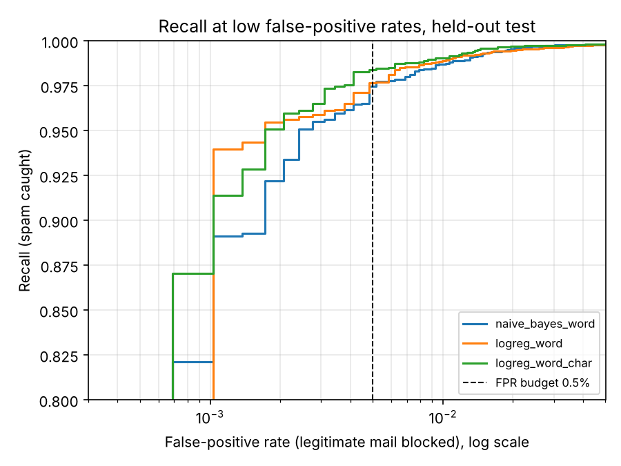
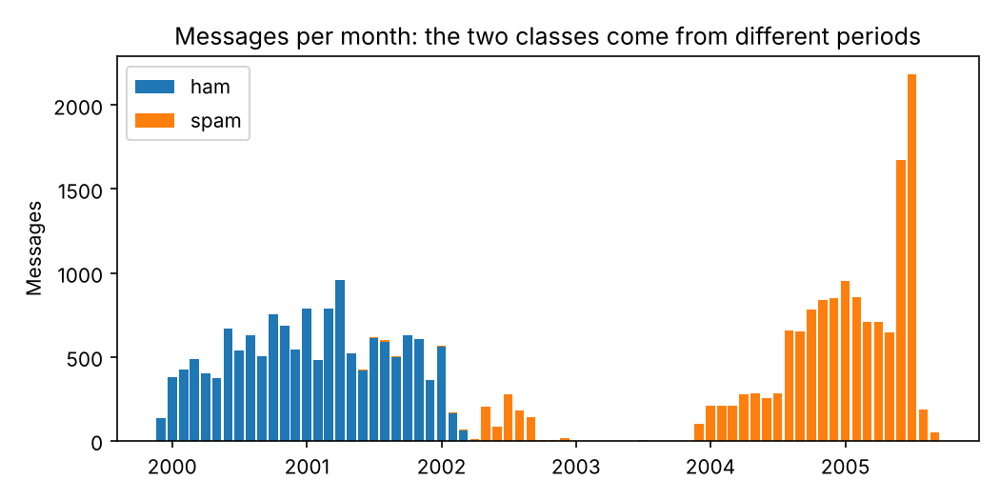
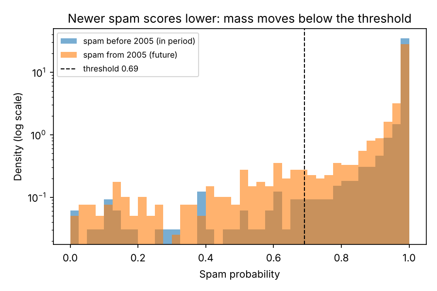

# Email abuse detection: leakage controls, operating points, drift and error analysis

A spam/abuse classifier on the Enron-Spam corpus (33,716 emails). The model itself is
simple on purpose. Most of the effort went into the parts that decide whether a
detection system can be trusted in production: catching the shortcuts that make offline
metrics look better than they are, choosing a threshold from a product constraint
rather than a default of 0.5, quantifying uncertainty, checking how the model degrades
on newer abuse, and turning the misses into named failure modes.


## Results (held-out test set, 5,815 messages)

Operating point: the highest recall with no more than **0.5% of legitimate mail
blocked**. The threshold is chosen on the validation split and applied unchanged to test.

| Model | Recall | Precision | False-positive rate | PR-AUC |
|---|---|---|---|---|
| Naive Bayes, word TF-IDF (baseline) | 96.80% | 99.50% | 0.48% | 0.9989 |
| Logistic regression, word TF-IDF | 97.49% | 99.51% | 0.48% | 0.9982 |
| **Logistic regression, word + char n-grams (selected)** | **97.63%** | **99.58%** | **0.41%** | 0.9988 |

* 95% bootstrap intervals for the selected model: recall 97.1-98.2%, FPR 0.21-0.65%.
* McNemar's test against the baseline on the same test messages: the selected model is
  right where the baseline is wrong 51 times and the reverse 25 times (p = 0.004).
* All numbers come from `reports/metrics.json`, written by the pipeline.



## What the analysis found

**1. The corpus contains label shortcuts, and a naive model uses them.**
In this dataset, all ham was collected from Enron mailboxes between 1999 and 2002, and 92%
of spam is dated 2003-2005. 46% of ham mentions "enron"; 0.007% of spam does. An
unmasked model's strongest ham features are `enron`, `vince`, `louise` and `houston`, and
"2005" ranks among its strongest spam features. None of that exists in real traffic.
The selected model is trained with mailbox-identity tokens and four-digit years removed,
and that step is bundled inside the saved artifact so serving cannot skip it.

A first attempt replaced identity tokens with a placeholder (`_id_`). The model learned
the placeholder as its single strongest ham feature: the shortcut had been renamed, not
removed. Tokens are now deleted, and a regression test guards against that.



**2. Duplicates and campaigns would inflate the test score.**
After normalising case, digits and whitespace, 4,592 messages (13.6%) are duplicates.
Spam also arrives in campaigns, with the largest single template sent 63 times. Data is
de-duplicated before splitting, and the split is grouped by template, so no campaign
appears in both train and test (checked: 0 template groups cross splits).

**3. Performance decays on newer spam.**
A model trained only on spam sent before 2005 catches 97.2% of held-out pre-2005 spam
but 91.7% of 2005 spam at the same threshold. The population stability index of the
score distribution is 0.38 (above 0.25 is conventionally a significant shift). In
production this argues for monitoring score PSI and retraining on a schedule, not only
when someone notices.



**4. Misses cluster in very short messages.**
Of the 69 spam messages the selected model misses, 39% have bodies under 200 characters,
against 13% of spam overall (lift 3.0). There is little text to classify, so the next
gain is more likely to come from non-text signals (sender, links, headers) than from a
bigger text model. The 12 false positives are mostly legitimate bulk mail: newsletters,
registration confirmations and a charity appeal. That is the grey zone where policy, not
the model, should decide what "abuse" means.

## How it is built

```
src/abuse_detect/
  data.py            download (SHA-256 pinned), cleaning, de-duplication, grouped split, masking
  sql/*.sql          exploratory analysis in DuckDB: volumes, class profile, term log-odds,
                     campaigns, link rate over time
  analysis.py        runs every .sql file and writes reports/tables/*.csv
  models.py          candidate pipelines and feature introspection
  evaluate.py        FPR-constrained thresholding, bootstrap CIs, McNemar, PSI
  error_analysis.py  rule-based tagging of misses into failure modes, with lift
  pipeline.py        end-to-end experiment, figures, packaged artifact plus metadata
  serve.py           FastAPI scoring service (/v1/score, /healthz)
tests/               18 unit tests on synthetic data (no network needed), run in CI
configs/default.yaml every experiment setting; its hash is stamped into the artifact
```

Design decisions and their trade-offs are written up in [docs/DESIGN.md](docs/DESIGN.md).

## Run it

```bash
make install        # pip install -e ".[dev]"
make data           # download, verify checksum, clean, split
make run            # SQL analysis, model selection, evaluation, stress tests (~10 min on 2 CPUs)
make test
make serve          # http://localhost:8000/docs
```

```bash
curl -s localhost:8000/v1/score -H 'content-type: application/json' \
  -d '{"subject": "limited offer", "body": "cheap meds online, click here to order now"}'
# {"spam_probability": ..., "decision": "block", "threshold": 0.856..., "model_version": "logreg_word_char-..."}
```

## Limitations

* The corpus is 20 years old and was pre-tokenised by its publishers, so absolute numbers
  are not comparable to a modern mail stream. The method transfers; the figures do not.
* Identity masking removes the obvious mailbox cues, but ham is still dominated by
  energy-trading vocabulary (`gas`, `deal`, `meter`). A model for another organisation
  would need its own ham.
* The error taxonomy is rule-based. It is good for counting and triage, not a substitute
  for reviewing examples.

## Data

[Enron-Spam](https://github.com/MWiechmann/enron_spam_data) (Metsis, Androutsopoulos and
Paliouras, 2006), CSV compilation by M. Wiechmann. Raw data is downloaded at run time
and not committed.
